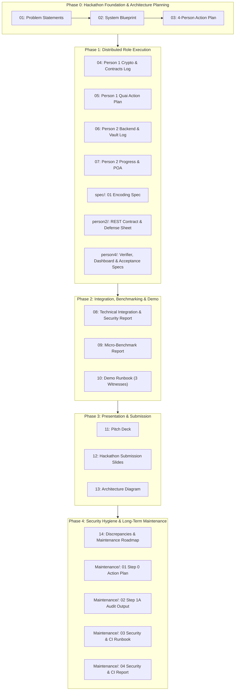

# TRUSTTRACE Master Documentation Index & Progression Flow

This document serves as the master navigation map for all architecture specifications, implementation logs, benchmark data, demo runbooks, and maintenance procedures for the **TRUSTTRACE** project (*The Big Hack 2.0 - Problem Statement B3*).

Documents and subdirectories are sequentially numbered to reflect the end-to-end lifecycle and chronological progress of the project.

---

## 🗺️ Progression Flowchart

---

## 📂 Root Documentation Index

| # | File | Type | Description |
| :-: | :--- | :--- | :--- |
| **00** | [`00_DOCUMENTATION_INDEX.md`](file:///Users/sukruthasrigadde/stuff/NeuroNova/Docs/00_DOCUMENTATION_INDEX.md) | Navigation | **Master documentation map** (this file). |
| **01** | [`01_THE_BIG_HACK_PROBLEM_STATEMENTS.pdf`](file:///Users/sukruthasrigadde/stuff/NeuroNova/Docs/01_THE_BIG_HACK_PROBLEM_STATEMENTS.pdf) | Foundation | The original problem statement for *The Big Hack 2.0* (Track B3: Surviving Root Compromise). |
| **02** | [`02_TRUSTTRACE_BLUEPRINT.docx`](file:///Users/sukruthasrigadde/stuff/NeuroNova/Docs/02_TRUSTTRACE_BLUEPRINT.docx) | Design | Initial comprehensive system blueprint and architectural vision. |
| **03** | [`03_TRUSTTRACE_4_PERSON_ACTION_PLAN.pdf`](file:///Users/sukruthasrigadde/stuff/NeuroNova/Docs/03_TRUSTTRACE_4_PERSON_ACTION_PLAN.pdf) | Strategy | Work breakdown structure, role distribution (P1-P4), and phase deliverables. |
| **04** | [`04_PERSON_1_CRYPTO_AND_CONTRACTS_LOG.md`](file:///Users/sukruthasrigadde/stuff/NeuroNova/Docs/04_PERSON_1_CRYPTO_AND_CONTRACTS_LOG.md) | Role Log | Person 1 execution prompts and validation checkpoints (EIP-712, Merkle tree, Solidity contracts). |
| **05** | [`05_PERSON_1_QUAI_ACTION_PLAN.md`](file:///Users/sukruthasrigadde/stuff/NeuroNova/Docs/05_PERSON_1_QUAI_ACTION_PLAN.md) | Strategy | Quai Network (Cyprus-1 shard) cross-chain anchoring architecture and simulation plan. |
| **06** | [`06_PERSON_2_BACKEND_AND_VAULT_LOG.md`](file:///Users/sukruthasrigadde/stuff/NeuroNova/Docs/06_PERSON_2_BACKEND_AND_VAULT_LOG.md) | Role Log | Person 2 execution prompts and checkpoints (durable vault, SQLite index, TCP rsyslog ingestion). |
| **07** | [`07_PERSON_2_PROGRESS_AND_POA.md`](file:///Users/sukruthasrigadde/stuff/NeuroNova/Docs/07_PERSON_2_PROGRESS_AND_POA.md) | Status | Person 2 mid-hackathon status report, component readiness, and interface handoffs. |
| **08** | [`08_TECHNICAL_INTEGRATION_AND_SECURITY_VALIDATION_REPORT.md`](file:///Users/sukruthasrigadde/stuff/NeuroNova/Docs/08_TECHNICAL_INTEGRATION_AND_SECURITY_VALIDATION_REPORT.md) | Technical Report | Complete architecture report detailing data flows, 46-byte canonical serialization, and the 3-witness verification model. |
| **09** | [`09_BENCHMARK_REPORT.md`](file:///Users/sukruthasrigadde/stuff/NeuroNova/Docs/09_BENCHMARK_REPORT.md) | Performance | Empirical micro-benchmarks (490k leaves/sec), odd-node Merkle scaling up to 10k leaves, gas amortization, and jury defense Q&A. |
| **10** | [`10_DEMO_RUNBOOK_AND_DISCREPANCY_RESOLUTION.md`](file:///Users/sukruthasrigadde/stuff/NeuroNova/Docs/10_DEMO_RUNBOOK_AND_DISCREPANCY_RESOLUTION.md) | Runbook | Step-by-step solo rehearsal and live demonstration runbook for the 3 forensic witnesses. |
| **11** | [`11_TRUSTTRACE_PITCH_DECK.pdf`](file:///Users/sukruthasrigadde/stuff/NeuroNova/Docs/11_TRUSTTRACE_PITCH_DECK.pdf) | Deck | Presentation slide deck for judges and stakeholders. |
| **12** | [`12_HACKATHON_SUBMISSION_SLIDES.pptx`](file:///Users/sukruthasrigadde/stuff/NeuroNova/Docs/12_HACKATHON_SUBMISSION_SLIDES.pptx) | Slides | Formal hackathon submission slide deck. |
| **13** | [`13_ARCHITECTURE_DIAGRAM.png`](file:///Users/sukruthasrigadde/stuff/NeuroNova/Docs/13_ARCHITECTURE_DIAGRAM.png) | Asset | High-resolution visual architectural diagram illustrating the multi-tier defense. |
| **14** | [`14_DISCREPANCIES_AND_MAINTENANCE_ROADMAP.md`](file:///Users/sukruthasrigadde/stuff/NeuroNova/Docs/14_DISCREPANCIES_AND_MAINTENANCE_ROADMAP.md) | Roadmap | Comprehensive technical discrepancy audit, resolution log, and post-hackathon maintenance roadmap. |

---

## 📁 Subdirectory Indices

### 1. [`Docs/spec/`](file:///Users/sukruthasrigadde/stuff/NeuroNova/Docs/spec/) — Core Wire Specifications
Specifications defining the frozen byte-level wire protocol:
- **`01_ENCODING.md`** — Canonical serialization format (46 + N bytes), SHA-256 leaf encoding, domain separation, and endianness rules.

### 2. [`Docs/person2/`](file:///Users/sukruthasrigadde/stuff/NeuroNova/Docs/person2/) — Vault Backend Specifications
Contracts and defense notes developed for the centralized evidence vault:
- **`01_REST_API_CONTRACT.md`** — REST endpoint contracts for sources, events, batches, checkpoints, and sequence gaps.
- **`02_DEFENCE_CHEAT_SHEET.md`** — Fast-lookup Q&A cheat sheet for defending SQLite concurrency, JSONL durable append, and fsync ordering.

### 3. [`Docs/person4/`](file:///Users/sukruthasrigadde/stuff/NeuroNova/Docs/person4/) — Verifier & Dashboard Specifications
Client-facing verification engine, frontend dashboard, and UI acceptance criteria:
- **`01_API_CONTRACT_PROPOSAL.md`** — Initial proposal for verifier-to-vault communication.
- **`02_TEAM_INTERFACE_APPROVAL.md`** — Formal interface sign-off between P2 (vault) and P4 (verifier/dashboard).
- **`03_VERIFIER_SPEC.md`** — Standalone cryptographic audit engine specification (three-witness cross-verification).
- **`04_DASHBOARD_SPEC.md`** — Real-time reactive monitoring dashboard UI specification.
- **`05_PERSON2_REVIEW_CHECKLIST.md`** — Mutual code and schema review checklist between P2 and P4.
- **`06_ACCEPTANCE_CHECKLIST.md`** — End-to-end integration acceptance gates.
- **`07_PHASE6_DEMO_RUNBOOK.md`** — Phase 6 live demo script connecting dashboard, verifier, and attacking agents.

### 4. [`Docs/Maintenance/`](file:///Users/sukruthasrigadde/stuff/NeuroNova/Docs/Maintenance/) — Security Hygiene & CI Automation
Post-demo security hardening, secret sanitization, toolchain pinning, and CI automation (PR #15):
- **`01_STEP_0_READ_ONLY_INVENTORY_AND_ACTION_PLAN.md`** — Initial discovery inventory and read-only action plan for hygiene execution.
- **`02_STEP_1A_READ_ONLY_AUDIT_OUTPUT.md`** — Audit output confirming denylisted addresses and compromised key surface area.
- **`03_SECURITY_HYGIENE_TOOLCHAIN_AND_CI_RUNBOOK.md`** — Complete execution runbook for secrets removal, compiler pinning (Solidity 0.8.19), Node 24 toolchain pinning, and GitHub Actions CI.
- **`04_SECURITY_HYGIENE_AND_CI_EXECUTION_REPORT.md`** — Final verification report certifying 421/421 tests green, dual Node 22/24 CI matrix parity, and teammate migration instructions.
