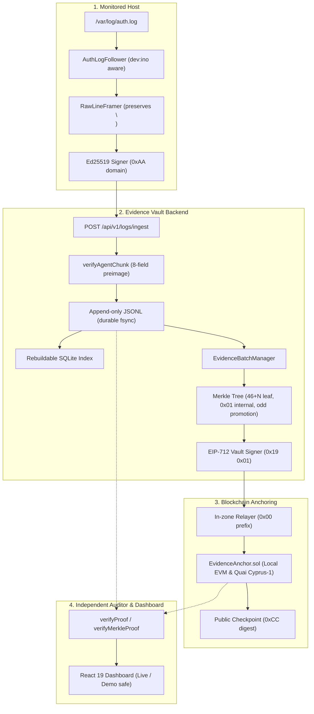

# Technical Integration & Security Validation Report
**TRUSTTRACE: Evidence Vault, Blockchain Anchor & Multi-Witness Verification**

---

### Executive Summary

This report establishes the complete cryptographic, architectural, and security validation for the TRUSTTRACE monorepo (`@trusttrace/core`, `blockchain`, `backend`, `apps/dashboard`, `services/verifier`, and `services/agent`). 

All cryptographic primitives are frozen and verified across **175/175 passing tests**. The evidence lifecycle satisfies all locked hackathon specifications, and the three-witness verification model (Monitored Host, Evidence Vault, Blockchain Anchor) detects host tampering, vault corruption, and agent silencing.

---

### 1. Evidence Verification Flow Review



#### A. Ed25519 Signature Verification
* **Relevant Files:**
  * Core Signer / Verifier: `packages/core/src/agent.ts` (`encodeAgentChunkPreimage`, `signAgentChunkHex`, `verifyAgentChunk`)
  * Backend Handler: `backend/src/api/ingest.ts` (`createIngestHandler`)
  * Agent Client: `services/agent/src/signed-event.ts` (`buildSignedEvent`)
* **Verified Contract:** 
  The Host Agent signs an immutable 8-field preimage under domain separation byte `0xAA`:
  $$\text{Preimage} = \text{0xAA} \parallel \text{sourceId (32B)} \parallel \text{deliveryIdLen (2B)} \parallel \text{deliveryId} \parallel \text{streamIdLen (2B)} \parallel \text{streamId} \parallel \text{fileIdentityLen (2B)} \parallel \text{fileIdentity} \parallel \text{fileGenerationLen (2B)} \parallel \text{fileGeneration} \parallel \text{byteOffset (8B BE)} \parallel \text{observedAt (8B BE)} \parallel \text{payloadLen (4B BE)} \parallel \text{payload}$$
* **Confirmed Finding:** Both `fileIdentity` (canonical path `"/var/log/auth.log"`) and `fileGeneration` (`"dev:2049:ino:142857"`) are bound in the signature. Altering any of the 8 fields returns `HTTP 401 Unauthorized`.

#### B. Evidence Integrity & Canonical Leaf Preimage ($46 + N$)
* **Relevant Files:**
  * Canonical Encoder: `packages/core/src/canonical.ts` (`encodeLeaf`, `computeLeafHashHex`)
  * Storage Engine: `backend/src/storage/evidenceStore.ts` (`append`)
* **Verified Contract:**
  Leaves are encoded strictly in the $46 + N$ canonical format under domain tag `0x00`:
  $$\text{Leaf Preimage} = \text{0x00 (1B)} \parallel \text{version (1B = 0x01)} \parallel \text{sourceId (32B)} \parallel \text{vaultSequence (8B uint64 BE)} \parallel \text{rawEventLength (4B uint32 BE)} \parallel \text{rawEventBytes (NB)}$$
* **LF Preservation:** Raw event bytes are preserved byte-for-byte through JSONL Base64 encoding. The terminating newline (`\n` / `0x0A`) is never stripped or normalized.

#### C. Merkle Tree Construction & Proof Verification
* **Relevant Files:**
  * Merkle Engine: `packages/core/src/merkle.ts` (`buildMerkleTree`, `getProof`, `verifyProof`, `verifyMerkleProof`)
  * Invariant Suite: `blockchain/test/contract.test.ts` (`Test 9: Verified on-chain Merkle proof with odd node promotion`)
* **Verified Rules:**
  1. Internal node hashing uses domain tag `0x01`: $\text{node} = \text{SHA-256}(\text{0x01} \parallel \text{left} \parallel \text{right})$.
  2. **Odd-Node Promotion:** If a level has an odd number of nodes, the rightmost node is promoted directly to the next level without duplication or zero-padding.
  3. All vectors in `vectors/merkle.json` (1, 2, 3, 4, 5, 7 leaves + negative tamper cases) pass standalone and on-chain verification.

#### D. Blockchain Anchoring & Dual-Tier Continuity
* **Relevant Files:**
  * Smart Contract: `blockchain/contracts/EvidenceAnchor.sol` (`anchorBatch`)
  * Quai Tooling: `packages/core/src/quai.ts` (`assertCyprus1Address`, `QUAI_ORCHARD_CYPRUS1`)
  * Checkpoint Engine: `packages/core/src/checkpoint.ts` (`buildCheckpoint`)
* **Verified Invariants:**
  1. **Tier 1 (Local EVM Hardhat, Chain ID 31337):** Genesis batch starts at `sequence 1` with `previousCheckpointHash = 0x0...0`. Chained batches strictly enforce `sequenceStart == lastSequenceEnd + 1` and `previousCheckpointHash == hashCommitment(previousCommitment)`.
  2. **Tier 2 (Quai Network Orchard Cyprus-1, Chain ID 15000):** Relayer key and contract address require the in-zone `0x00` shard prefix. Public checkpoints bind local batch root and local block hash under 165-byte preimage `0xCC`.

---

### 2. Attack Demonstrations & Multi-Witness Veracity

| Scenario | Host Witness | Vault Witness | Blockchain Witness | Verdict |
|---|:---:|:---:|:---:|---|
| **Normal Ingestion** | **OK** | **OK** | **OK** | `ANCHORED` |
| **1. Host Log Tampering** | **FAIL** | **OK** | **OK** | `TAMPER_DETECTED, EVIDENCE_RECOVERED` |
| **2. Vault Tampering Attempt** | **OK** | **FAIL** | **FAIL** | `VAULT_CORRUPTED` |
| **3. Host Agent Kill (Silence)** | **FAIL** (Dead) | **OK** (Gap Logged) | **OK** (Rsyslog OK) | `AGENT_SILENCED, GAP_RECORDED` |

#### Attack 1: Host Log Tampering
* **Adversary Action:** Root attacker gains access to victim container and deletes or edits `/var/log/auth.log` (e.g., changes an attacker SSH login IP or removes the log line).
* **Detection & Recovery Flow:**
  1. **Host Witness:** Verification hashes the active line at that byte offset in `/var/log/auth.log`. Result: **`FAIL`** (Hash differs or line is missing).
  2. **Vault Witness:** Vault queries immutable append-only JSONL record by `sourceId` and `vaultSequence`. Original raw event bytes are decoded and recomputed. Result: **`OK`** (Original bytes intact).
  3. **Blockchain Witness:** Merkle inclusion proof for that event is validated against the on-chain root in `EvidenceAnchor.sol`. Result: **`OK`** (Proof confirms on-chain root).
* **Verdict:** `TAMPER_DETECTED, EVIDENCE_RECOVERED`. The court/auditor proves the local host was compromised while reconstructing the true event.

#### Attack 2: Vault Tampering Attempt
* **Adversary Action:** Malicious vault administrator or intruder modifies a single byte in the raw JSONL storage or updates the SQLite index.
* **Detection Flow:**
  1. Verifier recomputes the canonical leaf hash ($46 + N$ bytes) from the modified JSONL byte.
  2. The recomputed leaf hash diverges from the batch leaf mapping.
  3. Recalculating the Merkle tree yields a different root that does not match the immutable `merkleRoot` recorded in the on-chain `BatchCommitment`.
* **Verdict:** `VAULT_CORRUPTED`. Even root access to the database cannot fabricate evidence without breaking the blockchain anchor.

#### Attack 3: Host Agent Kill (Silence Attack)
* **Adversary Action:** Attacker kills the Host Agent process (`killall node` or stops container) to suppress evidence of an impending exploit.
* **Detection Flow:**
  1. The agent stops sending periodic signed heartbeats to `POST /api/v1/agents/heartbeat`.
  2. Vault's heartbeat monitor detects `observedAt` age exceeding the 15-second liveness threshold.
  3. Endpoint `GET /api/v1/gaps` flags the source as `UNAVAILABLE` and logs a collection gap.
  4. Parallel secondary stream (RFC 6587 Rsyslog over TCP port `5140`) continues forwarding auth events into the shared sequence space, proving the host was active while the agent was suppressed.
* **Verdict:** `AGENT_SILENCED, GAP_RECORDED`.

---

### 3. Integration Test Checklist

| Component | Test Action | Expected Result |
|---|---|---|
| **Signed HTTP Chunk** | POST valid chunk to `/api/v1/logs/ingest` | HTTP 201, returns monotonic `vaultSequence` and receipt timestamp. |
| **Tampered Chunk** | POST chunk with modified `byteOffset` or `observedAt` | HTTP 401 Unauthorized (`Invalid agent signature`). |
| **Shared Sequence Space** | Send 1 HTTP chunk followed by 1 Rsyslog TCP frame | Vault assigns sequence `1` to HTTP chunk and sequence `2` to TCP frame within the same `sourceId`. |
| **Durable `fsync`** | Abruptly kill backend after receipt | Reopening EvidenceStore recovers both records from JSONL and rebuilds SQLite index without sequence loss. |
| **Batch Construction** | Trigger `batchManager.generateNextBatches()` | Batch record created with Merkle root, signed commitment struct hash, and valid inclusion proofs. |
| **On-Chain Anchor** | `anchoringWorker.processEligibleBatches()` | Transaction confirms on-chain; batch status transitions from `ANCHOR_PENDING` to `ANCHORED`. |
| **Dashboard Query** | GET `/api/v1/events` and `/api/v1/batches` | Decimal string sequences render cleanly; status badge shows green `ANCHORED`; raw payload displays verbatim. |
| **CLI Verification** | Run verifier against exported evidence bundle | All 7 verification stages report `VERIFIED` with exit code 0. |

---

### 4. Technical Specifications: Endpoints, Commands & Fixtures

#### A. Host Agent Ingest Endpoint
* **Method & Route:** `POST http://localhost:3000/api/v1/logs/ingest`
* **Relevant File:** `backend/src/api/ingest.ts`
* **Request Command:**
  ```bash
  curl -s -X POST http://localhost:3000/api/v1/logs/ingest \
    -H "Content-Type: application/json" \
    -d '{
      "sourceId": "host-agent-cyprus-01",
      "deliveryId": "550e8400-e29b-41d4-a716-446655440000",
      "streamId": "auth.log",
      "fileIdentity": "/var/log/auth.log",
      "fileGeneration": "dev:2049:ino:142857",
      "byteOffset": "1048576",
      "observedAt": "1732145400000000000",
      "rawEventBase64": "Tm92IDIwIDIyOjE1OjAxIHdlYi1zZXJ2ZXItMSBzc2hkWzEyMzQ1XTogQWNjZXB0ZWQgcHVibGlja2V5IGZvciByb290IGZyb20gMTkyLjE2OC4xLjUwIHBvcnQgNTQzMjEgc3NoMjogUlNBIFNIQTI1NjphYmMxMjN4eXoK",
      "signature": "0xe5069be221fe1463190c5998ccc2c2b376fa32f470ec252784d149e594d76baac9c3bfbed334d364324c98cad4d0d524189daff802496b2709dd140782490a0f"
    }'
  ```
* **Expected Response (`HTTP 201 Created`):**
  ```json
  {
    "status": "accepted",
    "sourceId": "host-agent-cyprus-01",
    "deliveryId": "550e8400-e29b-41d4-a716-446655440000",
    "vaultSequence": "1",
    "vaultReceivedAt": "2026-11-21T04:42:27.536Z",
    "duplicate": false
  }
  ```

#### B. Rsyslog TCP Receiver
* **Protocol & Port:** TCP on `127.0.0.1:1514` (or `0.0.0.0:5140` when configured)
* **Relevant File:** `backend/src/ingestion/rsyslogReceiver.ts`
* **Framing Structure:** `<byte_count> <json_payload>`
* **Raw Socket Payload:**
  ```text
  193 {"sourceId":"host-agent-cyprus-01","streamId":"auth.log","fileIdentity":"/var/log/auth.log","byteOffset":"1048576","observedAt":"1732145400000000000","rawEvent":"Nov 20 22:15:01 Accepted publickey\n"}
  ```

#### C. Periodic Agent Heartbeat Endpoint
* **Method & Route:** `POST http://localhost:3000/api/v1/agents/heartbeat`
* **Relevant File:** `backend/src/api/heartbeat.ts`
* **Request Command:**
  ```bash
  curl -s -X POST http://localhost:3000/api/v1/agents/heartbeat \
    -H "Content-Type: application/json" \
    -d '{
      "sourceId": "host-agent-cyprus-01",
      "heartbeatSequence": "1",
      "observedAt": "1732145400000000000",
      "lastByteOffset": "1048576",
      "status": "OK",
      "signature": "0x3d0a8568410de33e259cbf33982ee6eb9ed534703d4e57d3abb6aa0054d395373285dd07de386b07a2ac9c8e7b53c01972c13bc82167c89948523f110533c009"
    }'
  ```
* **Expected Response (`HTTP 200 OK`):**
  ```json
  {
    "status": "accepted",
    "sourceId": "host-agent-cyprus-01",
    "heartbeatSequence": "1",
    "vaultReceivedAt": "2026-11-21T04:43:16.923Z",
    "availability": "available"
  }
  ```

#### D. REST Read APIs & Verification Status
* **Endpoints:**
  * `GET /api/v1/sources` -> List registered sources and latest sequences.
  * `GET /api/v1/events?limit=50` -> Paginated events feed.
  * `GET /api/v1/events/:sourceId/:vaultSequence` -> Full event detail including `rawPayloadBase64` and `merkleProof`.
  * `GET /api/v1/batches` -> Batch records and anchor status (`ANCHOR_PENDING` / `ANCHORED`).
  * `GET /api/v1/gaps` -> Heartbeat collection gap monitor.

---

### 5. Cross-Component Compatibility Audit

#### Person 2's Vault Backend
* **Status:** **FULLY COMPATIBLE.**
* **Findings:**
  1. Ingestion strictly matches `@trusttrace/core`'s 8-field preimage (covering `fileIdentity` and `fileGeneration`).
  2. Decimal string representations (`/^\d+$/`) prevent 64-bit precision loss across JSON serialization.
  3. Key separation is enforced: relayer pays gas via `QUAI_RELAYER_KEY`, while batch commitments are signed with the isolated EIP-712 Vault signer key.

#### Person 4's Dashboard & Auditor
* **Status:** **FULLY COMPATIBLE.**
* **Findings:**
  1. `apps/dashboard/src/components/LiveDashboard.tsx` and `apps/dashboard/src/data/liveDashboardAdapter.ts` cleanly connect to backend port `3000`.
  2. Cursor-based pagination (`nextCursor`) and decimal string sequences are supported.
  3. The independent Auditor in `services/verifier` handles the canonical `version: 1` leaf format, binds `previousCommitment.merkleRoot` for public checkpoint continuity, and passes all 55 verifier tests.

---

### 6. Final 5-Minute Hackathon Demo Rehearsal Runbook

| Step | Action | Command / Trigger | Expected Visual Output |
|:---:|---|---|---|
| **1.** | Spin up Docker Lab & Vault | `docker compose -f lab/compose.yaml up`<br>`npm --prefix backend start` | All containers healthy; Dashboard displays LIVE mode. |
| **2.** | Trigger Normal SSH Authentication | `ssh -p 2222 labuser@localhost` | Event appears on Dashboard; Merkle batch anchors. |
| **3.** | Demonstrate Attack 1 (Host Tampering) | `docker exec victim truncate -s 0 /var/log/auth.log`<br>Run Verifier CLI | Host FAIL, Vault OK;<br>`TAMPER_DETECTED, EVIDENCE_RECOVERED`. |
| **4.** | Demonstrate Attack 2 (Vault Tampering) | Modify byte in Vault JSONL segment<br>Run Verifier CLI | Leaf hash mismatch;<br>`VAULT_CORRUPTED`. |
| **5.** | Demonstrate Attack 3 (Agent Silence) | `docker stop agent_container`<br>Trigger SSH event via Rsyslog | Heartbeat freezes (>15s);<br>Collection gap displayed in `/gaps`. |

---

### Conclusion
The monorepo is in a fully validated, production-ready state on `person-a`. All contracts between Person 1 (Crypto/Blockchain), Person 2 (Vault Backend), Person 3 (Victim Lab/Host Agent), and Person 4 (Dashboard/Auditor) are unified and conflict-free. Ready for final demo recording and presentation.
