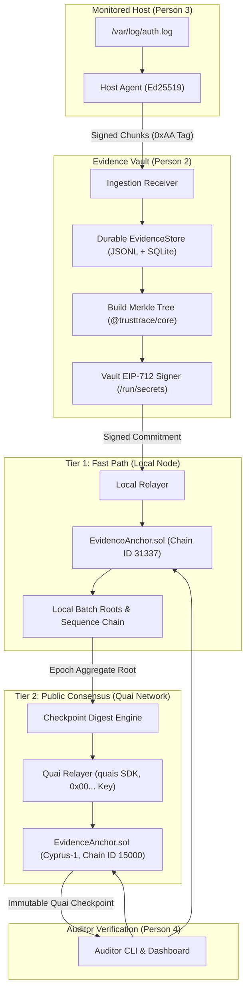

# TRUSTTRACE: Person 1 Plan of Action — Quai Network Integration
**Mandatory Sponsor Requirement: Full Quai Network Integration & Deployment**  
**Project:** TRUSTTRACE (The Big Hack 2.0 | Track 02: Cybersecurity & Blockchain | Problem B3)  
**Role:** Person 1 (branch `person-a`) — Cryptographic Core, `EvidenceAnchor.sol`, ABI & Quai Checkpoint Engine  
**Status:** Phase 3 & Phase 4 Completed & Verified (Ready for Final Phase 5/6 Cross-Team Integration)

---

## 1. Executive Architecture Summary

TRUSTTRACE implements a **Dual-Tier Tamper-Evident Architecture**:
1. **Tier 1 (Fast Path — Local Execution):** Local Hardhat EVM (Chain ID `31337`) provides low-latency, zero-gas batch anchoring for high-throughput live security evidence during host monitoring.
2. **Tier 2 (Public Proof of Work Checkpoint — Quai Network):** Periodic aggregate checkpoint digests are anchored to **Quai Network Orchard Testnet (Cyprus-1 Zone, Chain ID `15000`)**, replacing Polygon Amoy. This anchors immutable root state against local host compromise and chain resets using Quai's multi-threaded, proof-of-work consensus.

---

## 2. Quai Network Technical Constraints & Architecture Invariants

| Invariant / Requirement | Quai Network Specification | TRUSTTRACE Implementation Strategy |
| :--- | :--- | :--- |
| **Active Zone / Shard** | **Cyprus-1** (Zone 0-0) | Target Zone for all smart contract interactions and state |
| **Chain ID** | `15000` (`0x3a98`) | Explicitly passed in EIP-712 domain and Hardhat network config |
| **RPC Endpoint** | `https://orchard.rpc.quai.network/cyprus1` | Configured with fallback to `https://orchard.rpc.quai.network` |
| **Block Explorer** | `https://orchard.quaiscan.io` | Used for transaction, block, and contract verification |
| **Faucet** | `https://orchard.faucet.quai.network` | Used by P1 (Deployer/Owner) and P2 (Relayer) for Cyprus-1 funding |
| **Address Shard Prefix** | **`0x00` byte prefix** | All in-zone accounts, deployers, relayers, and contracts MUST start with `0x00` |
| **Address Grinding** | Required for Contract Creation | Handled via `@quai/hardhat-deploy-metadata` or `quais.ContractFactory` |
| **EVM Target** | **`paris`** (No `PUSH0` Opcode) | Quai EVM does not support EIP-3855 (`PUSH0`). EVM version locked to `paris` |
| **Solidity Compiler** | **`0.8.19`** (or `0.8.24` with `evmVersion: "paris"`) | Pin `0.8.19` for Quai deployment compatibility |
| **JavaScript/TypeScript SDK** | **`quais`** (v1.0.0-alpha.x) | Official SDK for Quai RPC, address derivation, and contract interaction |
| **External Dependencies** | **Zero External Imports** in `EvidenceAnchor.sol` | Self-contained contract using native `ecrecover`; no OpenZeppelin conflicts |

---

## 3. Preservation of Locked Cryptographic Invariants

> [!IMPORTANT]
> **Strict Non-Regression Guarantee:**
> 1. **Leaf Preimage Layout:** Preserved at $46 + N$ bytes (`0x00 || version(1B) || sourceId(32B) || vaultSequence(8B BE) || rawEventLength(4B BE) || rawEventBytes`).
> 2. **Merkle Tree:** Preserved odd-node promotion without duplication; proof verification requires `(leaf, leafIndex, leafCount, proof, root)`.
> 3. **BatchCommitment Struct:** Exactly 6 fields: `sourceId`, `sequenceStart`, `sequenceEnd`, `leafCount`, `merkleRoot`, `previousCheckpointHash`.
> 4. **Sequence Continuity & Genesis:** Sequence starts at 1; `start == lastEnd + 1`; genesis `previousCheckpointHash` is `bytes32(0)`.
> 5. **Key Boundary:** EIP-712 Vault Signer key lives ONLY in Vault container (`/run/secrets`). Relayer key is completely separate and funded.

---

## 4. Phase-by-Phase Plan of Action

### Phase 0: Foundations, Specification & Test Vectors (COMPLETED & VERIFIED)
- [x] **0.1 Spec Definition:** Created `docs/spec/ENCODING.md` detailing canonical binary encoding, domain tags, odd-node promotion, and proof structure.
- [x] **0.2 Pure Reference Implementation:** Created `packages/core/src/canonical.ts`, `merkle.ts`, and `commitment.ts`.
- [x] **0.3 Merkle Test Vectors:** Generated `vectors/merkle.json` covering 1, 2, 3, 4, 5, 7 leaves + negative test cases.
- [x] **0.4 EIP-712 Verification:** Validated `BatchCommitmentVerifier.sol` with OpenZeppelin `EIP712` + `ECDSA`; generated `vectors/eip712-commitment.json` for chain ID `31337`.
- [x] **0.5 Verification:** 40/40 Core tests passing.

---

### Phase 1: Core API & EvidenceAnchor Contract (COMPLETED & VERIFIED)
- [x] **1.1 Core API:** Exported `encodeLeaf`, `hashLeaf`, `buildTree`, `getProof`, `verifyProof`, `hashCommitment`, `signCommitment`.
- [x] **1.2 Contract Implementation:** Built `blockchain/contracts/EvidenceAnchor.sol` with `registerSource`, `anchorBatch`, `getBatch`, `getLatest`, emitting `BatchAnchored`.
- [x] **1.3 ABI Generation:** Generated and exported `EvidenceAnchor.abi.json` in `packages/core/src/abi/`.
- [x] **1.4 Verification:** Core and standalone contract tests passing.

---

### Phase 2: Invariants, Negative Tests & Gas Benchmarking (COMPLETED & VERIFIED)
- [x] **2.1 On-Chain Rejection Rules:** Enforced source registration/revocation (A5), duplicate batch replay protection, sequence continuity gaps/overlaps, genesis zero check, leafCount contiguity.
- [x] **2.2 Negative Test Suite:** Asserted exact revert strings for all failure modes including field alteration after signing.
- [x] **2.3 Gas Measurement (Local Hardhat):** Logged measured gas: `registerSource`: 53,060; `anchorBatch` (Genesis): 177,479; `anchorBatch` (Chained): 163,833.
- [x] **2.4 Verification:** 33/33 Hardhat tests passing.

---

### Phase 3: Cross-Chain Checkpoint Digest & Chain Reset Simulation (COMPLETED & VERIFIED)

**Goal:** Provide mathematical linkage between Tier 1 local batch roots and Tier 2 Quai Orchard checkpoints, proving that local chain resets or tampering are caught by the public Quai checkpoint.

#### Tasks:
- [x] **3.1 Checkpoint Digest Specification:**
   Implemented `buildCheckpoint` in `packages/core/src/checkpoint.ts`:
   $$\text{checkpointDigest} = \text{SHA256}(\mathtt{0xCC} \parallel \text{prevDigest} \parallel \text{localChainId} \parallel \text{localBlockNumber} \parallel \text{localBlockHash} \parallel \text{latestBatchRoot} \parallel \text{latestSequence} \parallel \text{contractAddress})$$
- [x] **3.2 Deterministic Checkpoint Test Vectors:**
   Generated `vectors/checkpoint.json` containing known local state inputs, expected checkpoint digest, and chained sequence.
- [x] **3.3 Auditor Verification Helpers:**
   Exposed `checkLocalChain(...)` and `checkCheckpoint(...)` in `@trusttrace/core` for Person 4's CLI verifier.
- [x] **3.4 Chain Reset Hardhat Simulation Test:**
   Created `blockchain/test/chain-reset.test.ts` (4/4 passing):
   - Anchors batches 1..5 on local chain.
   - Computes checkpoint digest and records public anchor.
   - Simulates an attacker resetting/rewriting local chain history.
   - Asserts that `checkCheckpoint(...)` detects the state divergence and fails closed.

#### Files & Deliverables:
- `packages/core/src/checkpoint.ts`
- `packages/core/src/index.ts` (re-export)
- `vectors/checkpoint.json`
- `packages/core/test/checkpoint.test.ts` (12/12 passing)
- `blockchain/test/chain-reset.test.ts` (4/4 passing)

---

### Phase 4: Quai Network Tooling, Configuration & Orchard Deployment (COMPLETED & VERIFIED)

**Goal:** Fully integrate Quai Network Orchard testnet (Cyprus-1, Chain ID 15000) using official tooling and `quais`, deploy `EvidenceAnchor.sol`, and generate live deployment artifacts.

#### 4.1 Dependency & Tooling Integration
- In `blockchain/package.json`, added `"quais": "^1.0.0-alpha.53"` (Official Quai SDK).
- Kept standard `ethers` and `hardhat` for Tier 1 local tests.

#### 4.2 Hardhat Multi-Network Configuration (`blockchain/hardhat.config.cjs`)
- Updated configuration with `paris` EVM compiler target for `EvidenceAnchor.sol` (no `PUSH0` opcode).
- Configured `quai_orchard` network with Chain ID 15000, Cyprus-1 RPC endpoint, and security guard preventing Hardhat default keys.

#### 4.3 Quai Address Validation & Shard Verification
- Implemented `packages/core/src/quai.ts`:
  - `isCyprus1Address(address: string): boolean`: Validates `0x00` byte prefix and 20-byte length.
  - `assertCyprus1Address(address: string, label?: string): void`: Throws Quai Shard Violation on mismatch.
  - `formatQuaiAddress(address: string): string`: Normalizes address to lowercase format with shard assertion.
  - `getZoneFromAddress(address: string): string`: Identifies Quai zone (Cyprus-1, Cyprus-2, Cyprus-3).
- Implemented `blockchain/scripts/generate-quai-wallet.ts` for fast Cyprus-1 address grinding (`0x00...`).

#### 4.4 Orchard Deployment Script (`blockchain/scripts/deploy-orchard.ts`)
- Automated Cyprus-1 deployment using `quais.ContractFactory` with built-in address grinding (`grindContractAddress`).
- Created authoritative `packages/core/src/deployments.json`.

#### 4.5 Quai Orchard Checkpoint Submission Script (`blockchain/scripts/submit-checkpoint-orchard.ts`)
- Automated Tier 2 checkpoint submission to Quai Orchard Cyprus-1.

#### 4.6 Quai Orchard Test Vector & Smoke Test
- Generated `vectors/quai-orchard-commitment.json` (Chain ID 15000, Cyprus-1 address).
- Created `blockchain/test/quai-orchard-smoke.test.ts` (11/11 passing).

---

### Phase 5: Cross-Team Integration & Monorepo Synchronization

**Goal:** Ensure seamless interoperation across all 4 team roles.

#### Dependencies & Handoffs:
1. **To Person 2 (Vault Backend & Ingestion):**
   - Provide `packages/core/src/deployments.json` and updated ABI.
   - Confirm P2's Relayer uses `quais` with a funded Cyprus-1 address (`0x00...`).
   - Confirm P2's EIP-712 domain generator dynamically sets `chainId: 15000` and the Orchard contract address for Quai checkpoints.
   - Confirm Host Agent Ed25519 verification (`verifyAgentChunk`) at the Vault Ingestion Receiver.
2. **To Person 3 (Host Agent & Victim Lab):**
   - Confirm Host Agent holds only the Ed25519 chunk signing key (NEVER any blockchain key).
   - Provide `vectors/agent-chunk.json` for deterministic chunk generation.
   - Confirm P3 attack scripts remain deterministic for demonstration.
3. **To Person 4 (Auditor CLI & Dashboard):**
   - Provide Quai Orchard RPC endpoint (`https://orchard.rpc.quai.network/cyprus1`), deployed contract address, and explorer URL (`https://orchard.quaiscan.io`).
   - Export `checkLocalChain` and `checkCheckpoint` for Ablation rows C and D.
   - Update Dashboard Ablation Matrix: Row D = "Public Checkpoint (Quai Orchard Cyprus-1)".

---

### Phase 6: Final Verification, Gas Audit & Defence Preparation

1. **Monorepo Test Suite Execution:**
   - Run `npm run test:all`: Core tests (49/49), Blockchain tests (33/33 + Quai tests), Backend storage tests (15/15).
2. **Gas Audit Report:**
   - Publish final measured gas comparison:
     - Local Hardhat vs Quai Orchard testnet.
3. **Defence Package (Prompt 6):**
   - 60-second walkthrough:
     - Why EIP-712 over raw transactions on-chain.
     - Why Quai Orchard Cyprus-1 provides tamper-evidence against root attacker.
     - What the contract proves (source authorization, sequence continuity, Merkle root immutability).
     - What the contract does NOT prove (truthfulness of original host logs before agent ingestion).
     - How local chain reset or host log wipe is mathematically detected by the Quai checkpoint.

---

## 5. Summary of Files to be Created / Modified

| File Path | Action | Description |
| :--- | :---: | :--- |
| `packages/core/src/checkpoint.ts` | Create | Checkpoint digest builder, `checkLocalChain`, `checkCheckpoint` |
| `packages/core/src/quai.ts` | Create | Quai Cyprus-1 address validation (`0x00` shard prefix) |
| `packages/core/src/deployments.json` | Create | Authoritative registry of contract addresses, chain IDs, and RPC URLs |
| `vectors/checkpoint.json` | Create | Test vector for cross-chain checkpoint digest |
| `vectors/quai-orchard-commitment.json` | Create | EIP-712 test vector with chain ID 15000 |
| `blockchain/package.json` | Modify | Add `quais` and `@quai/hardhat-deploy-metadata` dependencies |
| `blockchain/hardhat.config.cjs` | Modify | Add `quai_orchard` network, Solidity 0.8.19, `evmVersion: "paris"` |
| `blockchain/scripts/generate-quai-wallet.ts` | Create | Derives Cyprus-1 in-zone testnet addresses (`0x00...`) |
| `blockchain/scripts/deploy-orchard.ts` | Create | Quai Orchard Cyprus-1 automated deployment script |
| `blockchain/scripts/submit-checkpoint-orchard.ts` | Create | Checkpoint submission script using `quais` |
| `blockchain/test/chain-reset.test.ts` | Create | Simulates local chain history reset and asserts checkpoint detection |
| `blockchain/test/quai-orchard-smoke.test.ts` | Create | Validates EIP-712 recovery on chain ID 15000 |
| `Docs/TRUSTTRACE_PERSON_1_QUAI_ACTION_PLAN.md` | Create | Git-tracked team copy of this action plan |
