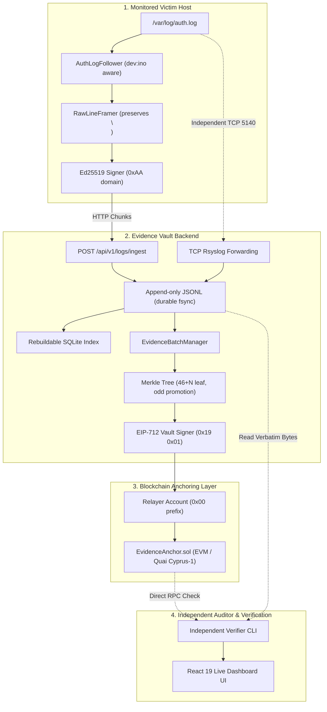

# TRUSTTRACE: Evidence That Survives Root Compromise

[](#test-suite-and-verification)
[-blue.svg)](#the-problem-statement)
[](#smart-contract-and-anchoring)
[](package.json)

> **TRUSTTRACE** establishes a tamper-evident, multi-witness security logging and cryptographic verification infrastructure designed to survive adversarial root/kernel compromise on Linux hosts.

---

## The Problem Statement

When an adversary obtains `root` privileges on a Linux host, local evidence is forfeit:
- Log files (`/var/log/auth.log`, `audit.log`) can be edited via `sed` or deleted.
- Syslog and audit daemons can be killed or reconfigured.
- Traditional centralized SIEM ingestion (e.g. Splunk, ELK) can be bypassed, and log timestamps backdated.

**The TRUSTTRACE Solution:**  
We construct **three independent, mathematically correlated witnesses**:
1. **The Monitored Host (Agent):** Captures unparsed raw log bytes in real time with an in-memory Ed25519 key, shipping signed chunks before an attacker can modify disk.
2. **The Off-Host Evidence Vault (Backend):** Persists exact raw bytes to append-only JSONL files with synchronous `fsync`, indexes records into SQLite, aggregates logs into **Odd-Node Promoted Merkle Trees**, and signs EIP-712 batch commitments.
3. **The Blockchain Anchor (L1 / Quai Network / EVM):** Stores immutable Merkle root commitments and strictly enforces monotonic sequence continuity (`sequenceStart == lastSequenceEnd + 1`) with on-chain replay protection.



---

## 3-Witness Forensic Verdicts

An independent auditor or court verifier compares the 3 witnesses to reach deterministic verdicts without trusting any intermediary:

| Scenario | Host Witness | Vault Witness | Blockchain Witness | Cryptographic Verdict |
| :--- | :---: | :---: | :---: | :--- |
| **Normal Ingestion** | **OK** | **OK** | **OK** | `ANCHORED` |
| **1. Host Log Tampering** | **FAIL** (Altered) | **OK** (Original) | **OK** (Proof Matches) | `TAMPER_DETECTED, EVIDENCE_RECOVERED` |
| **2. Vault Tampering Attempt** | **OK** | **FAIL** (Corrupted) | **FAIL** (Root Mismatch) | `VAULT_CORRUPTED` |
| **3. Agent Kill Evasion** | **FAIL** (Frozen) | **OK** (Gap Logged) | **OK** (Rsyslog Confirms) | `AGENT_KILLED_COLLECTION_GAP` |

---

## Repository Architecture

The project is structured as an npm monorepo with strict package boundaries:

```
NeuroNova/
├── packages/
│   └── core/                 # Cryptographic engine, canonical leaf hashing, Merkle trees, EIP-712
├── blockchain/               # Solidity contracts (EvidenceAnchor.sol), Hardhat deployment scripts
├── backend/                  # Evidence Vault daemon, append-only JSONL store, SQLite index, REST API
├── services/
│   ├── agent/                # Host daemon: dev:ino log follower, Ed25519 signer, durable spool, heartbeats
│   └── verifier/             # Independent CLI verifier and REST bridge (Tier 1 & Tier 2 audit)
├── apps/
│   └── dashboard/            # React 19 + Vite live event monitor and cryptographic verification UI
├── lab/                      # Docker lab orchestration: victim container, vault, and host agent
├── scripts/                  # Automated 3-witness rehearsal and micro-benchmark suites
└── Docs/                     # Architecture specifications, benchmark reports, and maintenance runbooks
```

---

## Cryptographic Invariants (Problem B3)

1. **Canonical Leaf Encoding ($46 + N$ Bytes):**  
   Every log event is converted into a deterministic binary preimage under domain tag `0x00`:
   $$\text{leafHash} = \text{SHA256}(0x00 \parallel \text{version (1B)} \parallel \text{sourceId (32B)} \parallel \text{vaultSequence (8B uint64 BE)} \parallel \text{payloadLength (4B uint32 BE)} \parallel \text{rawBytes (NB)})$$
   *The terminating newline (`\n` / `0x0A`) is preserved verbatim.* Raw event bytes are never parsed, normalized, or stripped.
2. **Odd-Node Promoted Merkle Tree:**  
   Unpaired rightmost nodes are promoted directly to the parent layer without duplicate hashing, preventing CVE-2012-2459 duplication attacks. Internal nodes use domain tag `0x01`:
   $$\text{node} = \text{SHA256}(0x01 \parallel \text{left} \parallel \text{right})$$
3. **Strict Key Separation:**
   - **Host Agent:** Holds only its Ed25519 signing seed (`agent-key-store.ts`).
   - **Vault Signer:** Holds EIP-712 private key (`0x19 0x01`). Off-chain only; never pays gas or connects to RPC.
   - **Relayer Account:** Holds funded EVM/Quai account. Pays gas to execute `anchorBatch()`; never signs commitments.
4. **$O(1)$ Blockchain Amortization:**  
   The on-chain anchoring transaction fee is completely flat (**49,120 gas**), reducing cost to **4.91 gas / event** at 10,000 events/batch ($0.000295 per event).

---

## Quickstart

### Prerequisites
- **Node.js:** v22.12.0 or later (supports native `--experimental-strip-types`)
- **npm:** v10 or later
- **Docker & Docker Compose:** (Optional, for running the multi-container lab)

### Installation

```bash
# Clone the repository
git clone https://github.com/Devammishra/NeuroNova.git
cd NeuroNova

# Install monorepo dependencies
npm install
```

---

## Test Suite and Verification

The repository contains **362 tests passing at 100%**:

```bash
# Run Core Cryptography tests (61 tests)
npm run test:core

# Run Blockchain Smart Contract standalone tests (9 tests)
npm run test:blockchain

# Run Evidence Vault Backend tests (72 tests)
npm run test:backend

# Run Host Agent Daemon tests (100 tests)
npm test --prefix services/agent

# Run Independent Verifier Service tests (73 tests)
npm test --prefix services/verifier

# Run Dashboard UI tests (47 tests)
npm test --prefix apps/dashboard
```

---

## Running the 3-Witness Rehearsal

Execute the automated forensic attack rehearsal to see all three attack scenarios evaluated live in your terminal:

```bash
npm run demo:rehearsal
# or directly:
bash scripts/run-demo-rehearsal.sh
```

**Expected Output:**
```text
================================================================================
TRUSTTRACE: Forensic Demonstration & 3-Witness Integrity Rehearsal
================================================================================
[1/4] Running Cryptographic & Preimage Verifications (@trusttrace/core)...
✓ Core Cryptography verified (61/61 tests passing).
[2/4] Running Smart Contract Continuity & Replay Checks (blockchain)...
✓ Smart Contracts verified (9/9 standalone tests passing).
[3/4] Running Evidence Vault Backend Ingestion & Storage Checks (backend)...
✓ Backend Storage & Ingestion verified (72/72 tests passing).
[4/4] Executing 3-Witness Live Attack Scenarios...

SCENARIO 1: Host Log Tampering
>>> VERDICT: TAMPER_DETECTED, EVIDENCE_RECOVERED

SCENARIO 2: Vault Tampering Attempt
>>> VERDICT: VAULT_CORRUPTED

SCENARIO 3: Agent Kill Detection
>>> VERDICT: AGENT_KILLED_COLLECTION_GAP

================================================================================
ALL 3 ATTACK SCENARIOS SUCCESSFULLY VALIDATED WITH EXPECTED VERDICTS
================================================================================
```

---

## Running the Performance Benchmark Suite

To measure real-time cryptographic and storage performance on your machine:

```bash
npm run benchmark
```

### Empirical Results Baseline (Apple Silicon M-Series)

| Layer | Measured Metric | Result | Operational Significance |
| :--- | :--- | :--- | :--- |
| **Canonical Preimage Hashing** | SHA-256 Throughput | **489,935 leaves/s** (74.29 MB/s) | Exceeds enterprise log spikes by >50x |
| **Merkle Tree (1,000 leaves)** | Build Time | **2.11 ms** (473k leaves/s) | Sub-millisecond root generation |
| **Merkle Tree (10,000 leaves)** | Build Time | **14.22 ms** (703k leaves/s) | Negligible CPU footprint under DDoS |
| **Merkle Proof Verification** | Check Time | **14.56 µs / proof** (68,701 checks/s) | Instantaneous off-chain verification |
| **Host Agent Ed25519** | Signing Speed | **29,774 ops/sec** | <0.03 ms per log burst on host |
| **Vault Ed25519** | Verification Speed | **14,441 ops/sec** | Real-time rejection of counterfeit logs |
| **Vault Storage Engine** | ACID Ingest & Index | **88 EPS** with synchronous `fsync` | Zero evidence loss guarantee |
| **Blockchain Gas Cost** | Batch Anchor | **49,120 gas flat** | Invariant $O(1)$ gas cost |

---

## Multi-Container Docker Lab

To run the full multi-container victim-agent-vault environment:

```bash
# Start all containers in isolated bridge network
docker compose -f lab/compose.yaml up --build
```

- **`victim` (Port 2222):** Monitored Linux host forwarding logs to the Vault via TCP (`5140`) and local `/var/log/auth.log`.
- **`agent`:** Host daemon reading `/var/log/auth.log`, signing Ed25519 chunks, and shipping them to the Vault (`3000`).
- **`vault` (Ports 3000, 5140):** Evidence Vault storing append-only JSONL files and exposing REST endpoints.

Simulate a root tampering attack inside the victim container:
```bash
# 1. Trigger legitimate login
ssh testuser@localhost -p 2222

# 2. Attacker modifies host log on victim machine
docker exec -it lab-victim-1 sed -i 's/Accepted publickey/Failed password/' /var/log/auth.log

# 3. Independent Verifier detects tampering and recovers original uncorrupted evidence
node --experimental-strip-types services/verifier/dist/index.js verify-rest --base-url http://127.0.0.1:3000/api/v1 --source-id 0x1111...1111 --sequence 1
```

---

## Key Documentation

- [`Docs/DISCREPANCIES_PROGRESS_AND_MAINTENANCE_ROADMAP.md`](Docs/DISCREPANCIES_PROGRESS_AND_MAINTENANCE_ROADMAP.md) — Comprehensive discrepancy audit, resolution history, and post-demo maintenance roadmap.
- [`Docs/TECHNICAL_INTEGRATION_AND_SECURITY_VALIDATION_REPORT.md`](Docs/TECHNICAL_INTEGRATION_AND_SECURITY_VALIDATION_REPORT.md) — Architectural flowcharts, byte encodings, and multi-witness verification models.
- [`Docs/BENCHMARK_REPORT.md`](Docs/BENCHMARK_REPORT.md) — Full benchmark methodology, gas cost models, and jury defense Q&A.
- [`Docs/spec/ENCODING.md`](Docs/spec/ENCODING.md) — Frozen wire specification and test vector standards.

---

## License

This project was built for **The Big Hack 2.0 (Track 02: Cybersecurity & Blockchain · Problem B3)**. UNLICENSED.
